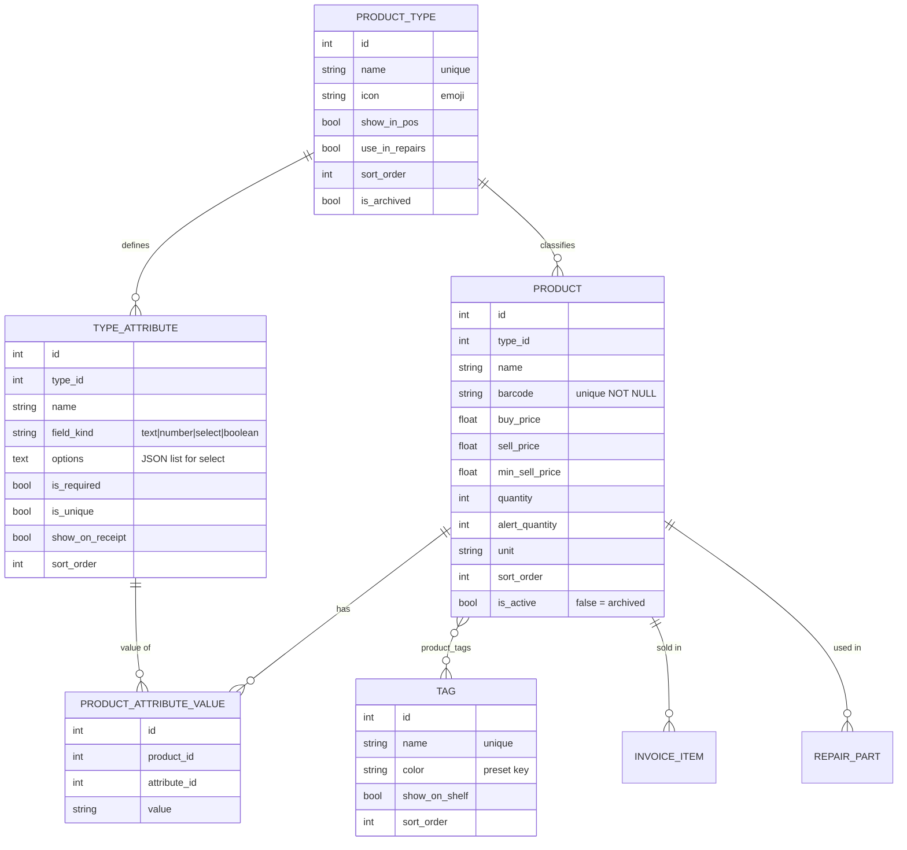
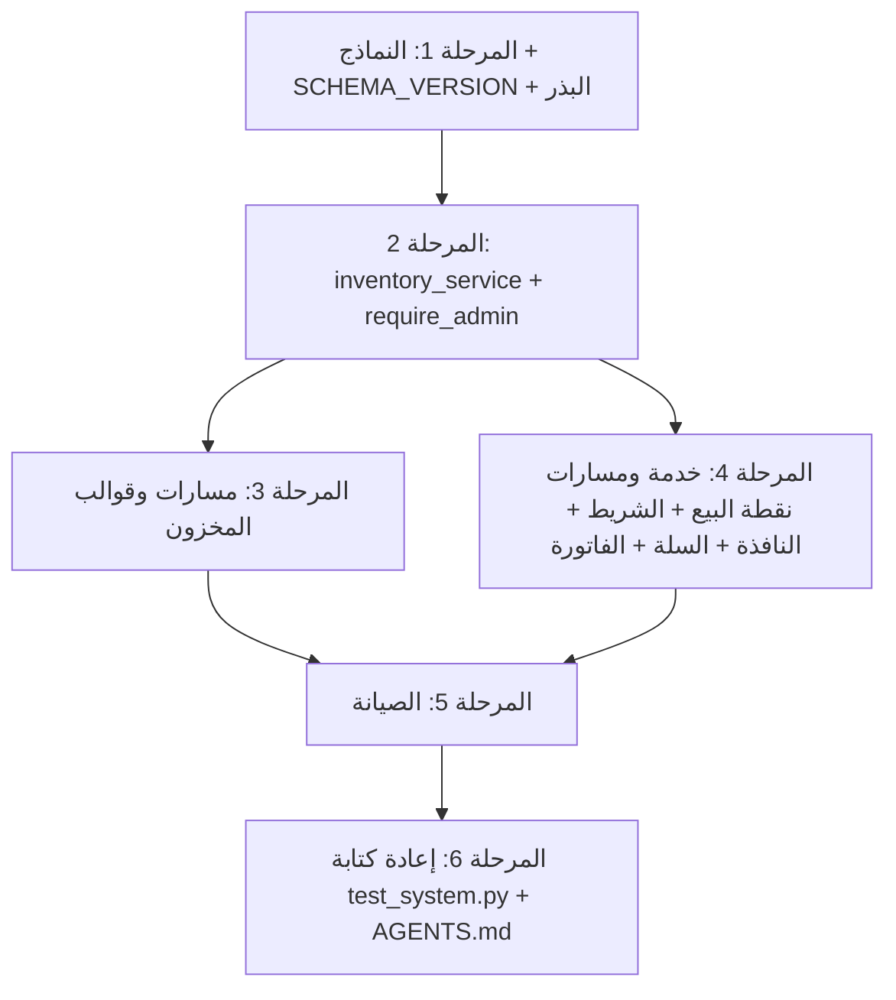

# خطة التنفيذ: المخزون الديناميكي (الأنواع + الخصائص + التاغات) ونافذة اختيار المنتجات في نقطة البيع

> **مرجع للوكيل المنفّذ:** هذه الخطة مكتوبة لتُنفَّذ بواسطة وكيل آخر دون الرجوع للمحادثة. اقرأ `AGENTS.md` أولاً، ثم هذه الخطة كاملة قبل كتابة أي كود.
> **ممنوع:** `git commit` / `git push` بدون طلب صريح من المستخدم. ممنوع فتح المتصفح. ممنوع أي CDN. الاختبارات تعمل على `test_mobi.db` فقط.

---

## 1. الهدف

تحويل المخزون من نظام ثابت (3 أنواع مبرمجة: `phone`/`accessory`/`spare_part` + تتبع IMEI مدمج) إلى نظام **ديناميكي** يديره المسؤول:

1. **الأنواع (Product Types):** يضيفها/يعدلها/يؤرشفها المسؤول. لكل نوع **خصائص مخصصة** (مثل IMEI، اللون، السعة) وخياران: يظهر في البيع / متاح في الصيانة.
2. **التاغات (Tags):** مجموعات حرة متعددة لكل منتج (مثل الماركة Samsung). المسؤول يختار أي التاغات تظهر في شريط نقطة البيع.
3. **شريط نقطة البيع** يصبح أزرار تصنيفات (أنواع أو تاغات بمفتاح تبديل) تفتح **نافذة اختيار** فوق لوحة الدفع فقط — لا تغطي السلة.
4. **إلغاء نظام IMEI المدمج نهائياً** — الـ IMEI يصبح مجرد خاصية "فريدة" يعرّفها المسؤول على نوع "هواتف".
5. **فلترة المخزون** (قابل للبيع / للصيانة / مؤرشف / نوع / تاغات / إخفاء النافد / بحث في قيم الخصائص).

---

## 2. سجل القرارات (من جلسة الأسئلة — ملزم للمنفّذ)

| # | القرار |
|---|---|
| 1 | خيارا **(يظهر في نقطة البيع)** و **(متاح كقطع غيار في الصيانة)** مستقلان ويمكن تفعيلهما معاً. |
| 2–3 | **حذف نظام IMEI المدمج نهائياً** (نموذج `ProductItem`، صفحة `imei_list.html`، `has_imei`، أعمدة IMEI في الفاتورة). كل منتج له **باركود** (من العلبة أو مولّد). |
| 3 | الـ IMEI يُعرّف يدوياً كخاصية لنوع "هواتف" عبر نظام الخصائص الديناميكي. |
| 4 | **النوع** شيء (واحد لكل منتج، يحدد الخصائص) و**التاغات** شيء آخر (متعددة لكل منتج، للتجميع). |
| 5 | الشريط فيه مفتاح تبديل **[الأنواع \| المجموعات]**؛ المجموعات = التاغات المفعّل لها "يظهر في الشريط". يُحفظ آخر اختيار في `localStorage`. |
| 6 | خيارا البيع/الصيانة على **النوع فقط**. منتج من نوع مخفي عن البيع لا يظهر في البيع حتى لو حمل تاغاً ظاهراً. |
| 7 | أنواع الخانات: **نص، رقم، قائمة اختيارات، نعم/لا**. لكل خاصية: **إلزامي**، **فريد لا يتكرر**، **يظهر في الفاتورة**. |
| 8 | كل وحدة لها خاصية فريدة = **منتج مستقل بكمية 1**. زر **[نسخ المنتج]** يملأ كل شيء عدا الخانات الفريدة والباركود. في نقطة البيع: **تجميع بصري** للمنتجات بنفس (الاسم + النوع) في بطاقة واحدة "iPhone 15 Pro — 5 وحدات" → عند الضغط قائمة وحدات تعرض **آخر 4 أرقام من الخاصية الفريدة بخط كبير** + الخصائص الأخرى + السعر. البحث في النافذة يشمل قيم الخصائص. |
| 9 | النافذة **تنزلق فوق عمود لوحة الدفع فقط** (نفس العرض والارتفاع)، تبقى مفتوحة لإضافة عدة منتجات، تُغلق بـ ✕ أو Esc أو بالضغط على نفس الزر. **قابلة للتمرير الرأسي داخلياً، والبطاقات بحجم ثابت.** |
| 10 | حذف نوع فيه منتجات **ممنوع**. المسموح: **نقل المنتجات لنوع آخر ثم حذفه**، أو **أرشفة النوع**. **لا حذف نهائي للمنتجات أبداً** (أرشفة فقط) لحماية الفواتير. |
| 11 | البيانات الحالية في `mobi.db` **غير مهمة** → إعادة إنشاء القاعدة بالهيكل الجديد وبيانات بداية جديدة (مع نسخة احتياطية تلقائية للملف القديم). |
| 12 | **المسؤول فقط** يدير الأنواع/الخصائص/التاغات ويضيف/يعدل/يؤرشف المنتجات والأسعار والكميات. الكاشير والفني: **عرض فقط وبدون سعر الشراء**. حماية **على مستوى السيرفر**. |
| 13 | تبويبات داخل صفحة المخزون: **[المنتجات \| الأنواع والخصائص \| المجموعات (التاغات)]**. فلاتر في الرابط (query string). |
| 14 | الباركود **إلزامي وفريد**. إن تُرك فارغاً يولّد السيرفر كوداً متسلسلاً (`MB000123`). **المسؤول يستطيع تعديله**. |
| 15 | المنتجات النافدة **تبقى في مكانها** باهتة وغير قابلة للضغط (حفظ مواقع ثابتة لذاكرة الكاشير). |
| 16 | **ترتيب يدوي** (`sort_order`) للأنواع والتاغات والمنتجات + أزرار ▲▼. الجديد يُضاف في النهاية. لا إعادة ترتيب تلقائية أبداً. |

---

## 3. مراجعة مطلوبة من المستخدم

> [!WARNING]
> **تغيير جذري في قاعدة البيانات:** عند أول تشغيل بعد التحديث، سيُعاد تسمية `mobi.db` القديم إلى `mobi.db.bak-YYYYMMDD-HHMMSS` وتُنشأ قاعدة جديدة فارغة ببيانات البداية. (موافَق عليه في القرار 11.)

> [!IMPORTANT]
> **تعديل دستور المشروع `AGENTS.md`:** القسم (ج) يفرض حالياً تتبع IMEI. سيُستبدل بقواعد المخزون الديناميكي حتى لا يعيد أي وكيل مستقبلي بناء نظام IMEI.

> [!NOTE]
> **قرارات افتراضية اتخذتها دون سؤال** (غيّرها قبل الموافقة إن أردت):
> - **حذف عمودي `brand` و `model` من المنتج:** الماركة تصبح **تاغ**، والموديل **خاصية** أو جزء من الاسم.
> - **فلترة التاغات في المخزون بنظام (و/AND):** اختيار Samsung + شواحن = المنتجات التي تحمل الاثنين.
> - **قائمة الوحدات داخل البطاقة المجمعة تعرض المتوفر فقط** (الوحدة المباعة خرجت فعلياً من المحل)، بينما **البطاقة المجمعة نفسها تبقى ثابتة في مكانها** وتصبح باهتة عند نفاد كل وحداتها.
> - **خانة IMEI في تذكرة الصيانة تبقى كما هي** — هي رقم جهاز **الزبون** عند الاستلام وليست مخزوناً.

---

## 4. نموذج البيانات الجديد



### 4.1 الملفات

#### [NEW] `app/models/product_type.py`
```python
import json
from datetime import datetime
from sqlalchemy import Column, Integer, String, Boolean, DateTime, ForeignKey, Text
from sqlalchemy.orm import relationship
from app.database import Base

FIELD_KINDS = ("text", "number", "select", "boolean")

class ProductType(Base):
    __tablename__ = "product_types"
    id = Column(Integer, primary_key=True, index=True)
    name = Column(String(100), unique=True, nullable=False)
    icon = Column(String(16), default="📦", nullable=False)
    show_in_pos = Column(Boolean, default=True, nullable=False)
    use_in_repairs = Column(Boolean, default=False, nullable=False)
    sort_order = Column(Integer, default=0, nullable=False, index=True)
    is_archived = Column(Boolean, default=False, nullable=False)
    created_at = Column(DateTime, default=datetime.utcnow)

    attributes = relationship("TypeAttribute", back_populates="product_type",
                              cascade="all, delete-orphan",
                              order_by="TypeAttribute.sort_order")
    products = relationship("Product", back_populates="product_type")

    @property
    def unique_attributes(self):
        return [a for a in self.attributes if a.is_unique]

    @property
    def has_unique_attribute(self) -> bool:
        return any(a.is_unique for a in self.attributes)


class TypeAttribute(Base):
    __tablename__ = "type_attributes"
    id = Column(Integer, primary_key=True, index=True)
    type_id = Column(Integer, ForeignKey("product_types.id"), nullable=False, index=True)
    name = Column(String(100), nullable=False)
    field_kind = Column(String(20), default="text", nullable=False)
    options = Column(Text, nullable=True)          # JSON list[str], only for "select"
    is_required = Column(Boolean, default=False, nullable=False)
    is_unique = Column(Boolean, default=False, nullable=False)
    show_on_receipt = Column(Boolean, default=False, nullable=False)
    sort_order = Column(Integer, default=0, nullable=False)

    product_type = relationship("ProductType", back_populates="attributes")
    values = relationship("ProductAttributeValue", back_populates="attribute",
                          cascade="all, delete-orphan")

    @property
    def options_list(self) -> list[str]:
        try:
            return json.loads(self.options) if self.options else []
        except ValueError:
            return []
```

#### [NEW] `app/models/tag.py`
```python
from sqlalchemy import Column, Integer, String, Boolean, ForeignKey, Table
from sqlalchemy.orm import relationship
from app.database import Base

TAG_COLORS = ("slate", "blue", "emerald", "amber", "red", "purple", "pink", "cyan")

product_tags = Table(
    "product_tags", Base.metadata,
    Column("product_id", Integer, ForeignKey("products.id", ondelete="CASCADE"), primary_key=True),
    Column("tag_id", Integer, ForeignKey("tags.id", ondelete="CASCADE"), primary_key=True),
)

class Tag(Base):
    __tablename__ = "tags"
    id = Column(Integer, primary_key=True, index=True)
    name = Column(String(60), unique=True, nullable=False)
    color = Column(String(20), default="blue", nullable=False)
    show_on_shelf = Column(Boolean, default=False, nullable=False)
    sort_order = Column(Integer, default=0, nullable=False, index=True)

    products = relationship("Product", secondary=product_tags, back_populates="tags")
```

#### [NEW] `app/models/attribute_value.py`
```python
from sqlalchemy import Column, Integer, String, ForeignKey, UniqueConstraint, Index
from sqlalchemy.orm import relationship
from app.database import Base

class ProductAttributeValue(Base):
    __tablename__ = "product_attribute_values"
    __table_args__ = (
        UniqueConstraint("product_id", "attribute_id", name="uq_product_attribute"),
        Index("ix_attr_value_lookup", "attribute_id", "value"),
    )
    id = Column(Integer, primary_key=True)
    product_id = Column(Integer, ForeignKey("products.id", ondelete="CASCADE"), nullable=False, index=True)
    attribute_id = Column(Integer, ForeignKey("type_attributes.id", ondelete="CASCADE"), nullable=False)
    value = Column(String(255), nullable=False)

    product = relationship("Product", back_populates="attribute_values")
    attribute = relationship("TypeAttribute", back_populates="values")
```

#### [NEW] `app/models/app_meta.py`
جدول مفتاح/قيمة لـ `schema_version` و `barcode_seq`.
```python
from sqlalchemy import Column, String
from app.database import Base

class AppMeta(Base):
    __tablename__ = "app_meta"
    key = Column(String(50), primary_key=True)
    value = Column(String(255), nullable=False)
```

#### [MODIFY] `app/models/product.py`
- حذف: `category_id`, `brand`, `model`, `has_imei`, علاقة `category`, علاقة `items`.
- إضافة: `type_id` (FK → `product_types.id`, NOT NULL, index), `sort_order` (Integer, index).
- `barcode`: `nullable=False, unique=True`.
- علاقات: `product_type`, `tags` (secondary=`product_tags`), `attribute_values` (cascade all, delete-orphan).
- خصائص مساعدة:
```python
    @property
    def is_unit(self) -> bool:
        """True if product's type has a unique attribute → quantity locked to 0/1."""
        return self.product_type.has_unique_attribute

    def attr_map(self) -> dict[int, str]:
        return {v.attribute_id: v.value for v in self.attribute_values}

    def display_attributes(self, receipt_only: bool = False) -> list[dict]:
        """Ordered [{'name','value','is_unique'}] following TypeAttribute.sort_order."""
        values = self.attr_map()
        out = []
        for a in self.product_type.attributes:
            if a.id in values and values[a.id] != "" and (not receipt_only or a.show_on_receipt):
                out.append({"name": a.name, "value": values[a.id], "is_unique": a.is_unique})
        return out

    @property
    def primary_unique_value(self):
        for a in self.product_type.attributes:
            if a.is_unique:
                return self.attr_map().get(a.id)
        return None

    @property
    def is_sellable(self) -> bool:
        return self.is_active and not self.product_type.is_archived and self.product_type.show_in_pos
```

#### [MODIFY] `app/models/invoice.py`
- `Invoice`: حذف علاقة `sold_items`.
- `InvoiceItem`: حذف `product_item_id`, `imei`, علاقة `product_item`. إضافة:
```python
    attributes_snapshot = Column(Text, nullable=True)  # JSON [{"name","value"}] of show_on_receipt attrs at sale time

    @property
    def snapshot_list(self) -> list[dict]:
        try:
            return json.loads(self.attributes_snapshot) if self.attributes_snapshot else []
        except ValueError:
            return []
```

#### [DELETE] `app/models/product_item.py`
#### [DELETE] `app/models/category.py`

#### [MODIFY] `app/models/__init__.py`
تصدير: `ProductType, TypeAttribute, Tag, product_tags, ProductAttributeValue, AppMeta` بدلاً من `Category, ProductItem`.

#### [KEEP] `app/models/repair.py`
`RepairTicket.imei` يبقى (جهاز الزبون). `RepairPart` بدون تغيير.

---

## 5. إصدار المخطط وإعادة إنشاء القاعدة

#### [MODIFY] `app/config.py`
```python
SCHEMA_VERSION = 2
```

#### [MODIFY] `app/database_init.py`
أضف قبل `Base.metadata.create_all(...)` دالة تُستدعى أولاً داخل `init_db()`:
```python
import sqlite3, shutil
from datetime import datetime
from app.config import DATABASE_PATH, SCHEMA_VERSION
from app.database import engine

def _ensure_schema_version():
    """If an existing DB has an older/unknown schema, back it up and start fresh."""
    if not DATABASE_PATH.exists() or DATABASE_PATH.stat().st_size == 0:
        return
    current = None
    con = sqlite3.connect(str(DATABASE_PATH))
    try:
        row = con.execute(
            "SELECT value FROM app_meta WHERE key='schema_version'"
        ).fetchone()
        current = int(row[0]) if row else None
    except sqlite3.Error:
        current = None  # table missing → legacy v1 schema
    finally:
        con.close()
    if current == SCHEMA_VERSION:
        return
    engine.dispose()  # release Windows file locks before renaming
    stamp = datetime.now().strftime("%Y%m%d-%H%M%S")
    backup = DATABASE_PATH.with_name(f"{DATABASE_PATH.name}.bak-{stamp}")
    shutil.move(str(DATABASE_PATH), str(backup))
    print(f"[MIGRATION] Old schema (v{current}) backed up to {backup.name}; creating fresh v{SCHEMA_VERSION} database.")
```
بعد `create_all` وقبل البذر: اكتب/حدّث `AppMeta(key="schema_version", value=str(SCHEMA_VERSION))` و `AppMeta(key="barcode_seq", value="0")` إن لم يوجدا.

> [!CAUTION]
> تحقق من `run.py` و `package_app.py` / `mobi.spec`: إن كان أيٌّ منها يستورد `Category` أو `ProductItem` أو يفحص جداول بعينها فحدّثه. أضف للنماذج الجديدة أي `hiddenimports` لازمة في `mobi.spec`.

### 5.1 بيانات البداية الجديدة (استبدل الأقسام 3 و 5 في `init_db`)
البذر **فقط إن كان جدول `product_types` فارغاً**. استخدم `sort_order` بمضاعفات 10.

| النوع | أيقونة | بيع | صيانة | الخصائص |
|---|---|---|---|---|
| هواتف | 📱 | ✓ | ✗ | IMEI (text, required, **unique**, receipt) · اللون (select: أسود، أبيض، أزرق، ذهبي، تيتانيوم طبيعي، تيتانيوم أسود — receipt) · السعة (select: 64GB، 128GB، 256GB، 512GB — receipt) · الحالة (select: جديد، مستعمل — receipt) |
| شواحن وكابلات | 🔌 | ✓ | ✗ | القدرة W (number) · نوع المنفذ (select: Type-C، Lightning، Micro USB) |
| حمايات وكفرات | 🛡️ | ✓ | ✗ | الموديل المتوافق (text) |
| سماعات وملحقات | 🎧 | ✓ | ✗ | — |
| بطاريات | 🔋 | ✓ | ✓ | السعة mAh (number) |
| شاشات | 📲 | ✗ | ✓ | الموديل المتوافق (text) |
| قطع غيار صيانة | 🛠️ | ✗ | ✓ | — |

**التاغات:** Apple (blue, shelf ✓) · Samsung (cyan, shelf ✓) · Anker (emerald, shelf ✓) · Xiaomi (amber, shelf ✗).

**المنتجات** (يجب الحفاظ على هذه الباركودات لأن الاختبارات تعتمد عليها):
| الاسم | النوع | باركود | كمية | شراء/بيع | تاغات | خصائص |
|---|---|---|---|---|---|---|
| شاحن سريع Anker 20W Type-C | شواحن | `6934177701234` | 25 | 35/55 | Anker | القدرة=20، المنفذ=Type-C |
| كيبل آيفون لايتنينج أصلي 1M | شواحن | `190198496245` | 18 | 40/70 | Apple | المنفذ=Lightning |
| Apple iPhone 15 Pro | هواتف | `IP15P-0001` | 1 | 3800/4250 | Apple | IMEI=`354892091234567`، اللون=تيتانيوم طبيعي، السعة=256GB، الحالة=جديد |
| Apple iPhone 15 Pro | هواتف | `IP15P-0002` | 1 | 3400/3850 | Apple | IMEI=`354892097654321`، اللون=تيتانيوم أسود، السعة=128GB، الحالة=جديد |
| بطارية Samsung A54 أصلية | بطاريات | `BAT-A54` | 6 | 60/110 | Samsung | السعة=5000 |
| شاشة Samsung Galaxy A54 5G أصلية | شاشات | `SP-A54-OLED` | 8 | 160/240 | Samsung | الموديل=A54 5G |

يبقى بذر المستخدمين، إعدادات المحل، والزبون النقدي كما هو.

---

## 6. طبقة الخدمات

#### [NEW] `app/services/inventory_service.py`
كل منطق الأعمال هنا؛ المسارات رقيقة. توقيعات مقترحة:

```python
class InventoryError(Exception):
    """Carries a user-facing Arabic message (and optional field errors dict)."""
    def __init__(self, message: str, field_errors: dict | None = None): ...

# ---------- Ordering ----------
def next_sort_order(db, model) -> int            # max(sort_order)+10, or 10
def move(db, model, obj_id: int, direction: int)  # swap sort_order with nearest neighbour (-1 up / +1 down); global scope per model

# ---------- Barcode ----------
def generate_barcode(db) -> str
    # increments AppMeta['barcode_seq'] → f"MB{seq:06d}"; loop until not used by any Product
def normalize_barcode(raw: str | None) -> str | None  # strip; '' → None

# ---------- Attribute validation ----------
def parse_attribute_form(form, product_type) -> dict[int, str]
    # reads fields named  attr_<attribute_id>; boolean checkbox → "1"/"0"
def validate_attribute_values(db, product_type, values: dict[int, str], product_id: int | None) -> dict[int, str]
    # returns {attribute_id: error_msg}. Rules:
    #  - required & empty → "هذه الخانة إلزامية"
    #  - number → float() parse, else "يجب إدخال رقم"
    #  - select → value in options_list
    #  - boolean → "1"/"0"
    #  - unique → no OTHER product (ANY status, incl. archived & sold) has same (attribute_id, value)
    #      message: f"القيمة مسجلة مسبقاً للمنتج: {other.name} (باركود {other.barcode})"

# ---------- Products ----------
def create_product(db, data: dict, attr_values: dict[int, str], tag_ids: list[int]) -> Product
    # barcode: normalize; if None → generate_barcode; if duplicate → InventoryError(field 'barcode')
    # if type.has_unique_attribute → quantity forced to 1
    # sort_order = next_sort_order(Product)  (always appended at end — decision 16)
def update_product(db, product_id, data, attr_values, tag_ids) -> Product
    # changing type_id is NOT allowed here (use move_products). Unit products: quantity ∈ {0,1}
def duplicate_prefill(db, product_id) -> dict
    # returns form defaults: same type/name/prices/unit/alert/tags + non-unique attr values;
    # barcode='' (auto on save), unique attrs='', quantity=1
def set_product_archived(db, product_id, archived: bool)
def update_stock(db, product_id, new_qty)  # unit products clamp to 0..1

# ---------- Types ----------
def create_type(db, name, icon, show_in_pos, use_in_repairs) -> ProductType
def update_type(db, type_id, ...) -> ProductType
def add_attribute(db, type_id, name, field_kind, options_text, is_required, is_unique, show_on_receipt)
    # options_text: one option per line (also accept Arabic comma '،' and ','), trimmed, de-duplicated
    # if is_unique and the type already has products with qty>1 → InventoryError
    #   "لا يمكن جعل الخاصية فريدة لأن بعض المنتجات كميتها أكبر من 1"
def update_attribute(db, attribute_id, ...)
    # field_kind change blocked if any value exists → "لا يمكن تغيير نوع الخانة بعد إدخال قيم لها"
    # turning is_unique ON blocked if duplicate values exist (report which value)
    # turning is_required ON allowed (enforced on next edit) — return warning count of products missing a value
def delete_attribute(db, attribute_id) -> int  # returns number of deleted values (UI confirms first)
def archive_type(db, type_id, archived: bool)
def delete_type(db, type_id)
    # only if ZERO products (incl. archived) → else InventoryError with count
def move_products(db, from_type_id, to_type_id) -> dict
    # for each product: re-map values to target attributes matching by (name, field_kind);
    # drop unmatched values; returns {"moved": n, "dropped_attributes": [names], "missing_required": [names]}
    # unique collisions in target → abort whole move with InventoryError (transaction rollback)
def preview_move(db, from_type_id, to_type_id) -> dict  # same report without writing (for the confirm modal)

# ---------- Tags ----------
def create_tag(db, name, color, show_on_shelf) -> Tag
def update_tag(db, tag_id, ...)
def delete_tag(db, tag_id) -> int   # detaches from products; returns affected count

# ---------- Queries ----------
def query_products(db, *, q=None, scope="all", type_id=None, tag_ids=(), hide_out=False)
    # scope: all (active only) | sale (active & type.show_in_pos & !type.archived)
    #        | repair (active & type.use_in_repairs & !type.archived) | archived (!active OR type.archived)
    # q: ilike on name, barcode, OR EXISTS attribute value ilike
    # tag_ids: AND semantics → one EXISTS per tag
    # order: Product.sort_order, Product.id
def build_pos_groups(products: list[Product]) -> list[dict]
    # key = (type_id, name.strip().casefold())
    # group = {"key_product_id": first.id, "name", "icon", "count_total", "units_available",
    #          "qty_available", "price_min", "price_max", "is_unit_group", "sort_order": min(sort_order)}
    # plain (non-unit) products with unique name → single card group (count_total=1)
    # groups sorted by sort_order → positions never change with stock (decision 15)
```

#### [MODIFY] `app/services/pos_service.py`
- احذف كل منطق `ProductItem`. عنصر السلة الجديد:
```python
{
  "cart_id": f"prod_{product.id}",
  "product_id": int, "name": str, "barcode": str,
  "attributes": [{"name","value"}],   # product.display_attributes(receipt_only=True)
  "unit_price": float, "buy_price": float,
  "quantity": int, "is_unit": bool, "max_quantity": int  # 1 if is_unit else product.quantity
}
```
- دالة داخلية مشتركة `_add_product(cart, product) -> (ok, msg)`:
  - رفض إن `not product.is_sellable` → `"هذا الصنف ({name}) مخصص للصيانة ولا يُباع من نقطة البيع"` أو `"الصنف مؤرشف"`.
  - رفض إن `quantity <= 0` → `"نفد من المخزون"`.
  - وحدة (`is_unit`) موجودة في السلة → `"هذه الوحدة مضافة بالفعل إلى السلة"`.
  - غير ذلك: زيادة الكمية حتى `max_quantity`.
- `add_to_cart_by_code(db, user_id, code)`:
  1. مطابقة **باركود** تامة على `Product` (أي حالة؛ الرفض يتم عبر `_add_product` برسالة واضحة).
  2. مطابقة **قيمة خاصية فريدة** تامة: `ProductAttributeValue.value == code` مع `TypeAttribute.is_unique`.
  3. **احذف** الرجوع إلى `Product.id` الرقمي (يتعارض مع الباركودات الرقمية).
- `add_to_cart_by_product_id(db, user_id, product_id)` للنافذة.
- `process_checkout`: **إعادة التحقق من المخزون** لكل سطر قبل الحفظ (رفض كامل إن نقص). اكتب `attributes_snapshot=json.dumps(item["attributes"], ensure_ascii=False)`. اخصم `product.quantity`.

---

## 7. الصلاحيات

#### [MODIFY] `app/routes/auth.py`
```python
from fastapi import HTTPException

def require_admin(request: Request, db: Session = Depends(get_db)) -> User:
    user = require_user(request, db)
    if user.role != "admin":
        raise HTTPException(status_code=403, detail="هذه العملية مخصصة لمدير النظام فقط")
    return user
```
- **كل** مسار يغيّر بيانات المخزون/الأنواع/التاغات يستخدم `Depends(require_admin)`.
- `GET /inventory` (تبويب المنتجات) متاح للجميع؛ القالب لا يرسم عمود سعر الشراء ولا أزرار الإدارة ولا تبويبي الأنواع/التاغات إلا للمسؤول. `GET /inventory?tab=types|tags` لغير المسؤول → 403.

---

## 8. المسارات (Endpoints)

### 8.1 المخزون — `app/routes/inventory.py` (إعادة كتابة)

| Method | Path | Guard | الوظيفة / الاستجابة |
|---|---|---|---|
| GET | `/inventory` | user | `tab=products` (افتراضي)\|`types`\|`tags`. فلاتر المنتجات: `q, scope, type_id, tags (متعدد), hide_out`. يرسم `inventory/index.html` |
| GET | `/inventory/product/new` | admin | partial نموذج إضافة (`inventory/_product_form.html`) يُحمّل في مودال عبر HTMX. `?type_id=` اختياري |
| GET | `/inventory/product/{id}/edit` | admin | partial نموذج تعديل |
| GET | `/inventory/product/{id}/duplicate` | admin | partial نموذج إضافة مملوء من `duplicate_prefill` |
| GET | `/inventory/type/{id}/fields` | admin | partial خانات الخصائص فقط (`inventory/_attribute_fields.html`) عند تغيير النوع في النموذج |
| POST | `/inventory/product/save` | admin | إنشاء/تحديث (`product_id` مخفي اختياري). نجاح → `HX-Redirect: /inventory?...` (يحافظ على الفلاتر عبر `return_url` مخفي). فشل → يعيد partial النموذج مع الأخطاء بـ **422** |
| POST | `/inventory/product/{id}/archive` | admin | أرشفة → redirect 303 |
| POST | `/inventory/product/{id}/restore` | admin | استعادة |
| POST | `/inventory/product/{id}/move?dir=up\|down` | admin | ترتيب |
| POST | `/inventory/product/update-stock` | admin | (موجود) — قيد الوحدات 0..1 |
| POST | `/inventory/types/create` | admin | إنشاء نوع → redirect لمحرر النوع |
| GET | `/inventory/types/{id}` | admin | صفحة محرر النوع `inventory/type_editor.html` |
| POST | `/inventory/types/{id}/update` | admin | الاسم/الأيقونة/الخياران |
| POST | `/inventory/types/{id}/attributes/add` | admin | إضافة خاصية |
| POST | `/inventory/attributes/{id}/update` | admin | تعديل خاصية |
| POST | `/inventory/attributes/{id}/delete` | admin | حذف خاصية (بعد تأكيد يعرض عدد القيم) |
| POST | `/inventory/attributes/{id}/move?dir=` | admin | ترتيب الخصائص داخل النوع |
| POST | `/inventory/types/{id}/archive` / `restore` | admin | أرشفة/استعادة |
| POST | `/inventory/types/{id}/delete` | admin | حذف (فقط إن صفر منتجات) |
| GET | `/inventory/types/{id}/move-preview?to=` | admin | JSON تقرير النقل للمودال |
| POST | `/inventory/types/{id}/move-products` | admin | `to_type_id` → نقل ثم redirect |
| POST | `/inventory/types/{id}/move?dir=` | admin | ترتيب الأنواع |
| POST | `/inventory/tags/create` | admin | إنشاء تاغ |
| POST | `/inventory/tags/{id}/update` | admin | الاسم/اللون/يظهر في الشريط |
| POST | `/inventory/tags/{id}/delete` | admin | حذف (يفصل عن المنتجات) |
| POST | `/inventory/tags/{id}/move?dir=` | admin | ترتيب |
| GET | `/inventory/barcode-labels` | user | (موجود) — حدّث ليعتمد `barcode` غير الفارغ دائماً، و`?product_id=` لطباعة ملصق منتج محدد |

**احذف:** `/inventory/product/add` القديم، `/inventory/product/{id}/imeis`، `/inventory/product/{id}/imei/add`.

### 8.2 نقطة البيع — `app/routes/pos.py`

| Method | Path | الوظيفة |
|---|---|---|
| GET | `/pos` | السياق الجديد: `shelf_types` (show_in_pos & !archived, مرتبة)، `shelf_tags` (show_on_shelf, مرتبة). **احذف `quick_products`** |
| GET | `/pos/picker?type_id=` أو `?tag_id=` و`&q=` | partial `pos/_picker_grid.html`: بطاقات المجموعات (`build_pos_groups`) ضمن نطاق الزر. منتجات التاغ تُقيّد أيضاً بـ `is_sellable` (القرار 6). مع `q`: نفس النطاق مفلتراً بالبحث (اسم/باركود/قيم خصائص) |
| GET | `/pos/picker/group/{product_id}` | partial `pos/_picker_units.html`: كل المنتجات النشطة المتوفرة بنفس (type_id, الاسم) مرتبة بـ sort_order |
| POST | `/pos/add-product` | `product_id` → `cart_partial.html` + `HX-Trigger: scanSuccess\|scanError` (نفس نمط `/pos/add-item`) |
| POST | `/pos/add-item` | (موجود) — يستخدم `add_to_cart_by_code` الجديد |

### 8.3 الصيانة — `app/routes/repairs.py`
- `view_ticket`: `available_parts` = منتجات نشطة، `quantity > 0`، نوعها `use_in_repairs=True` و `is_archived=False`، مرتبة بـ `sort_order`.
- `add_spare_part_to_ticket`: تحقق أن المنتج من نوع `use_in_repairs` وأن الكمية متوفرة فعلاً (لا تقصّ بصمت؛ ارفض برسالة).

---

## 9. الواجهات (Templates)

> قواعد عامة: عربي RTL، خط IBM Plex المحلي، Tailwind المحلي **المجمّع مسبقاً** (⚠️ الكلاسات الاعتباطية مثل `w-[175px]` **لا تعمل** — أي مقاس مخصص يُكتب في `app/static/css/custom.css`)، دعم الوضع الداكن، أزرار لمس ≥ 44px، معرّفات `id` فريدة لكل عنصر تفاعلي.

### 9.1 شريط نقطة البيع — `app/templates/pos/index.html`
استبدل محتوى "Fixed Bottom Quick Products Shelf" (الحاوية الخارجية ونظام التمرير الأفقي يبقيان):

- **رأس الشريط:** يمين: مفتاح تبديل مقسّم `#shelf-mode-types` / `#shelf-mode-tags` (`[الأنواع | المجموعات]`). يسار: أسهم ▶ ◀ الحالية.
- **الشريط:** `#quick-products-strip` يبقى (عجلة الماوس + اللمس). يعرض أحد قالبين حسب `shelfMode`:
  - زر نوع: `.pos-shelf-chip` = أيقونة + اسم. `id="shelf-type-{{ t.id }}"`.
  - زر تاغ: `.pos-shelf-chip` = نقطة لون + اسم. `id="shelf-tag-{{ tag.id }}"`.
  - الزر النشط (المفتوحة نافذته) مميز بإطار أزرق وخلفية.
  - حالة فارغة: "لا توجد مجموعات مثبتة في الشريط — يمكن للمسؤول تفعيلها من المخزون ← المجموعات".
- **CSS جديد** في `custom.css`: `.pos-shelf-chip { width: 150px; height: 56px; flex: 0 0 150px; ... }` بحجم ثابت موحد + حالات `:hover` و `.is-active` و `.dark`.

### 9.2 نافذة الاختيار (Picker) — داخل عمود لوحة الدفع
- أضف `relative` لحاوية عمود الدفع (`order-2 lg:order-1 ...`). أضف داخلها **كآخر عنصر**:
```html
<section id="pos-picker" x-show="pickerOpen" x-transition:enter="transition ease-out duration-150"
         x-transition:enter-start="opacity-0 translate-y-4" x-transition:enter-end="opacity-100 translate-y-0"
         class="absolute inset-0 z-20 bg-white rounded-xl border border-slate-300 shadow-xl flex flex-col min-h-0"
         style="display:none" @keydown.escape.window="closePicker()">
  <header class="flex items-center justify-between gap-2 p-2.5 border-b flex-shrink-0">
    <h2 class="font-black text-sm" x-text="pickerTitle"></h2>
    <input id="pos-picker-search" type="text" placeholder="بحث بالاسم أو الباركود أو آخر أرقام IMEI..." ...
           @input.debounce.250ms="reloadPicker()">
    <button id="pos-picker-close" type="button" @click="closePicker()">✕</button>
  </header>
  <div id="pos-picker-body" class="flex-1 min-h-0 overflow-y-auto p-2.5"><!-- HTMX partial --></div>
</section>
```
- **شبكة البطاقات** (`_picker_grid.html`): `.pos-picker-grid { display:grid; grid-template-columns: repeat(auto-fill, var(--pos-card-width)); gap: 8px; justify-content: start; }` وكل بطاقة `.pos-quick-card` (175×110 موجودة مسبقاً).
  - بطاقة منتج عادي: أيقونة النوع، الاسم (سطران)، السعر، شارة "متوفر: N". `hx-post="/pos/add-product"` `hx-vals='{"product_id": ID}'` `hx-target="#pos-cart-container"`. `id="picker-card-{{ id }}"`.
  - بطاقة مجموعة وحدات: الاسم، "N وحدات"، نطاق السعر (`min – max` أو سعر واحد). `hx-get="/pos/picker/group/{{ key_product_id }}"` `hx-target="#pos-picker-body"`.
  - **نافد:** نفس المكان، كلاس `.is-disabled` (opacity 0.45، `pointer-events:none`، شارة "نفد") — **لا يُحذف ولا يُنقل** (القرار 15).
- **قائمة الوحدات** (`_picker_units.html`): زر "→ رجوع" يعيد تحميل الشبكة. كل وحدة صف كبير قابل للضغط (`min-height: 64px`):
  - يسار: **آخر 4 أرقام** من `primary_unique_value` بخط `font-mono` كبير جداً (`text-3xl`)، وتحته القيمة كاملة صغيرة.
  - وسط: شارات الخصائص المعروضة في الفاتورة (اللون، السعة، الحالة).
  - يمين: السعر + زر إضافة. `hx-post="/pos/add-product"`. بعد الإضافة يُعاد تحميل القائمة (الوحدة المضافة تظهر "في السلة" معطلة).
- **سلوك Alpine** (أضف إلى `posApp()`):
```js
shelfMode: localStorage.getItem('mobi_pos_shelf_mode') || 'types',
pickerOpen: false, pickerScope: null, pickerTitle: '',
setShelfMode(m) { this.shelfMode = m; localStorage.setItem('mobi_pos_shelf_mode', m); this.closePicker(); },
togglePicker(kind, id, title) {
  if (this.pickerOpen && this.pickerScope && this.pickerScope.kind === kind && this.pickerScope.id === id) { return this.closePicker(); }
  this.pickerScope = { kind, id }; this.pickerTitle = title; this.pickerOpen = true;
  document.getElementById('pos-picker-search').value = '';
  this.reloadPicker();
},
reloadPicker() {
  if (!this.pickerScope) return;
  const q = document.getElementById('pos-picker-search').value.trim();
  const p = new URLSearchParams({ [this.pickerScope.kind + '_id']: this.pickerScope.id });
  if (q) p.set('q', q);
  htmx.ajax('GET', '/pos/picker?' + p.toString(), { target: '#pos-picker-body' });
},
closePicker() { this.pickerOpen = false; this.pickerScope = null; document.getElementById('barcode-scanner-input')?.focus(); },
```
- **تغذية راجعة:** عند `scanSuccess` تومض البطاقة بالأخضر (`.barcode-scan-success` موجودة) ويصدر `MoBiAudio.playSuccessBeep()`؛ عند `scanError` يظهر الخطأ (نفس آلية `/pos/add-item` الحالية).

> [!WARNING]
> **افحص `app/static/js/pos_scanner.js`:** إن كان يلتقط كل ضغطات المفاتيح أو يعيد التركيز تلقائياً إلى `#barcode-scanner-input`، فيجب أن يتجاهل الكتابة داخل `#pos-picker-search` (وأي `input` آخر) وإلا ستُسرق الكتابة من خانة بحث النافذة.

- عدّل نص `placeholder` في خانة الماسح: `"امسح الباركود أو الرقم المميز (IMEI/سيريال) ثم Enter [F2]..."`.

### 9.3 السلة والفاتورة
- `pos/cart_partial.html`: استبدل كتلة IMEI بشارات `item.attributes` (الخاصية الفريدة بخط `font-mono`). إخفاء أزرار ± عندما `item.is_unit` (عرض "1" ثابت).
- `pos/receipt.html`: استبدل `item.imei` بحلقة على `item.snapshot_list`: `<div style="font-size:9px">{{ a.name }}: {{ a.value }}</div>`.

### 9.4 المخزون — `app/templates/inventory/index.html` (إعادة بناء)
- **تبويبات** (روابط `?tab=`): المنتجات | الأنواع والخصائص* | المجموعات (التاغات)* (*للمسؤول فقط).
- **تبويب المنتجات:**
  - شريط فلترة (form GET، إرسال تلقائي عند التغيير): بحث `q` · أزرار مقسّمة `scope` [الكل | قابلة للبيع | للصيانة | مؤرشفة] · قائمة `type_id` · شرائح تاغات قابلة للتحديد المتعدد (checkbox مخفي `name="tags"`) · مفتاح `hide_out` · زر "مسح الفلاتر".
  - الجدول: الصنف (الاسم + ملخص الخصائص الصغير) · النوع (أيقونة + اسم + شارات 🛒/🔧 حسب الخيارين) · التاغات (شارات ملونة) · الباركود · الكمية (تحذير منخفض) · سعر الشراء* · سعر البيع · الإجراءات*: ✏️ تعديل · ⧉ نسخ · 🏷️ ملصق · ▲▼ · 🗄️ أرشفة/استعادة.
  - حالة فارغة ودّية مع زر "إضافة صنف".
- **مودال نموذج المنتج** (`_product_form.html`, محمّل بـ HTMX في حاوية `#product-modal-body`):
  - النوع (select؛ `hx-get="/inventory/type/{id}/fields"` يستبدل `#attribute-fields`؛ معطّل في وضع التعديل).
  - الاسم* · الباركود (اختياري، placeholder "يُولَّد تلقائياً عند الحفظ"، زر ماسح) · التاغات (checkboxes) · سعر الشراء* · سعر البيع* · أقل سعر بيع · الكمية (معطلة = 1 مع ملاحظة إن كان النوع يحوي خاصية فريدة) · حد التنبيه · الوحدة.
  - `#attribute-fields`: لكل خاصية حسب `field_kind`: `input text` / `input number step=any` / `select` / `checkbox`. اسم الحقل `attr_{{ a.id }}`. علامة * للإلزامي، 🔒 للفريد. رسالة الخطأ تحت الخانة.
  - بعد حفظ ناجح لمنتج جديد: إظهار تنبيه نجاح فيه زر **[طباعة ملصق]** (`/inventory/barcode-labels?product_id=`).
- **تبويب الأنواع:** بطاقات مرتبة: أيقونة، اسم، عدد المنتجات، مفاتيح 🛒 يظهر في البيع / 🔧 متاح في الصيانة (تحفظ فوراً عبر POST)، ▲▼، [تعديل الخصائص] → `/inventory/types/{id}`، [أرشفة]، [حذف] (معطل مع تلميح إن كان فيه منتجات)، [نقل المنتجات...] (مودال: اختيار النوع الهدف → `move-preview` يعرض الخصائص التي ستضيع → تأكيد). نموذج "نوع جديد" سريع في الأعلى.
- **محرر النوع** `inventory/type_editor.html`: الاسم، **منتقي أيقونات** (شبكة ~24 إيموجي محلية مسبقة: 📱📲🔌🔋🎧🛡️🛠️⌚💻🖥️📷🎮💾🔊🧲🪛📦🎁🧴🔦⚡🖱️⌨️🧩)، الخياران. جدول الخصائص: الاسم · نوع الخانة · الخيارات (textarea سطر لكل خيار، يظهر فقط لـ select) · إلزامي · فريد · في الفاتورة · ▲▼ · حذف. صف إضافة خاصية في الأسفل. رسائل المنع من الخدمة تظهر بوضوح.
- **تبويب المجموعات (التاغات):** قائمة: نقطة لون، الاسم، عدد المنتجات، مفتاح "يظهر في شريط البيع"، ▲▼، تعديل (اسم + لوحة 8 ألوان)، حذف (تأكيد: "سيُزال هذا التاغ من N منتج"). نموذج إضافة سريع.

### 9.5 حذف/تنظيف
- **[DELETE]** `app/templates/inventory/imei_list.html`.
- `inventory/barcode_labels.html`: إزالة أي إشارة لـ `brand`/`model`/`has_imei` إن وجدت.
- ابحث في كل القوالب عن: `has_imei`, `category`, `brand`, `model`, `imei` (ما عدا قوالب `repairs/` الخاصة بجهاز الزبون) وأصلحها.

---

## 10. تحديث `AGENTS.md`
- **القسم 1 – الركيزة 3** ("التتبع الدقيق للمخزون"): استبدل بنود IMEI بـ: أنواع منتجات ديناميكية بخصائص مخصصة (نص/رقم/قائمة/نعم-لا مع إلزامي/فريد/في الفاتورة)، تاغات للتجميع، باركود إلزامي فريد (مصنعي أو مولّد `MBxxxxxx`).
- **القسم 3 – الهيكل:** حدّث قائمة `models/` (احذف `category.py`, `product_item.py`؛ أضف `product_type.py`, `tag.py`, `attribute_value.py`, `app_meta.py`) و`services/inventory_service.py`.
- **القسم 4-ج** يُعاد كتابته بالكامل:
  - النوع يحدد الخصائص وخياري (البيع/الصيانة)؛ التاغات للتجميع ولا تؤثر على الظهور.
  - المنتج ذو الخاصية الفريدة = وحدة مستقلة بكمية 0/1؛ التحقق من عدم تكرار القيمة الفريدة عبر **كل** المنتجات.
  - لا حذف نهائي للمنتجات (أرشفة فقط)؛ حذف النوع فقط إن كان فارغاً.
  - الفاتورة تحفظ لقطة (snapshot) لخصائص "تظهر في الفاتورة".
  - الترتيب يدوي (`sort_order`) ولا يُعاد تلقائياً؛ النافد يبقى في مكانه معطلاً.
  - استهلاك قطع الغيار يتم فقط من أنواع `use_in_repairs`.
- **سياسة المخطط:** أي تغيير في الجداول يرفع `SCHEMA_VERSION`؛ بعد تسليم النظام لعملاء حقيقيين يجب كتابة ترحيل حقيقي بدلاً من إعادة الإنشاء.

---

## 11. ترتيب التنفيذ (للوكيل المنفّذ)



بعد **كل** مرحلة: `.\venv\Scripts\python.exe -c "import app.main"` للتأكد من عدم وجود أخطاء استيراد، ثم `grep` عن البقايا (`ProductItem|Category|has_imei|category_id|\.brand|\.model\b`) في `app/`.

---

## 12. خطة التحقق

### 12.1 الاختبارات الآلية — إعادة كتابة `test_system.py`
الحفاظ على حواجز الأمان الحالية (`IS_TESTING`, `test_mobi.db`, `test_uploads`) وتنظيف البيئة. ترقيم موحّد `[n/N]`. الاختبارات:

1. **ترحيل المخطط:** أنشئ ملف SQLite قديم يدوياً في `DATABASE_PATH` (جدول `categories` بدون `app_meta`) → `init_db()` → تأكد من وجود ملف `test_mobi.db.bak-*` ووجود جدول `product_types` و `schema_version=2`. احذف ملف الـ backup.
2. البذر: 7 أنواع، 4 تاغات، 6 منتجات، كلها بباركود.
3. `GET /auth/login` = 200.
4. دخول المسؤول.
5. `GET /pos` = 200 ويحتوي `shelf-type-` و `shelf-mode-tags`.
6. مسح باركود الشاحن `6934177701234` → 200 و "Anker" في السلة.
7. مسح IMEI `354892091234567` → 200، السلة تعرض الـ IMEI.
8. مسح نفس الـ IMEI مرة ثانية → 400 "مضافة بالفعل".
9. مسح باركود الشاشة `SP-A54-OLED` (صيانة فقط) → 400 ورسالة "مخصص للصيانة".
10. `GET /pos/picker?type_id=<هواتف>` → يحتوي "Apple iPhone 15 Pro" و "2 وحدات" (أو صيغتك المعتمدة).
11. `GET /pos/picker/group/<id>` → يحتوي "4567" و "4321".
12. `GET /pos/picker?type_id=<هواتف>&q=4321` → يحتوي بطاقة الآيفون.
13. `POST /pos/add-product` بالبطارية `BAT-A54` → 200.
14. الدفع (`/pos/checkout`) → نجاح؛ الفاتورة تحتوي `354892091234567`؛ كمية وحدة الآيفون المباعة = 0.
15. بعد البيع: `GET /pos/picker?type_id=<هواتف>` ما زال يعرض بطاقة الآيفون (1 وحدة) — الموقع ثابت.
16. المسؤول ينشئ نوعاً جديداً بخاصية فريدة إلزامية `Serial` → منتج بدون باركود → الباركود المولّد يبدأ بـ `MB`.
17. منتج ثانٍ بنفس `Serial` → **422** ورسالة "مسجلة مسبقاً".
18. منتج بدون قيمة للخاصية الإلزامية → 422.
19. حذف النوع وفيه منتجات → مرفوض؛ `move-products` إلى نوع آخر → ثم الحذف ينجح؛ المنتجات المنقولة بقيت (لا حذف).
20. تاغ: إنشاء، إسناد لمنتج، فلترة `GET /inventory?tags=<id>` تُظهره؛ `scope=sale` لا تُظهر الشاشة؛ `scope=repair` تُظهرها؛ حذف التاغ لا يحذف المنتج.
21. أرشفة منتج → يختفي من `scope=all` ويظهر في `scope=archived` ولا يُضاف للسلة بالمسح.
22. **الصلاحيات:** دخول `cashier` → `POST /inventory/types/create` = 403، `POST /inventory/product/save` = 403، `GET /inventory?tab=types` = 403، و`GET /inventory` = 200 **ولا يحتوي** عنوان عمود "سعر الشراء".
23. تذكرة صيانة: الإنشاء يعمل؛ صفحة التذكرة تعرض الشاشة والبطارية كقطع متاحة ولا تعرض الشاحن.
24. الأيقونة المفضلة (favicon) — كما هو.
25. رفع الشعار وتوليد ICO وإعادة الضبط — كما هو.

```powershell
.\venv\Scripts\python.exe test_system.py
```
يجب أن تنتهي بـ `ALL N TESTS PASSED` وألا يُلمس `mobi.db`.

### 12.2 التحقق اليدوي (المستخدم)
1. شغّل النظام: تأكد من ظهور ملف `mobi.db.bak-...` وأن البيانات الجديدة موجودة.
2. **المخزون ← الأنواع:** أنشئ نوعاً، أضف خصائص بأنواعها الأربعة، جرّب الترتيب ▲▼ والأرشفة والنقل والحذف.
3. **المخزون ← المجموعات:** فعّل "يظهر في الشريط" لتاغين.
4. **المنتجات:** أضف هاتفاً بـ IMEI ثم استخدم [نسخ] لإضافة وحدة ثانية؛ جرّب كل الفلاتر وتحديث الصفحة (تبقى الفلاتر).
5. **نقطة البيع:** بدّل [الأنواع | المجموعات]، افتح نافذة "هواتف": تغطي لوحة الدفع فقط، السلة ظاهرة، التمرير داخل النافذة يعمل، البطاقات بحجم موحّد. افتح بطاقة الآيفون المجمعة واختر وحدة بآخر 4 أرقام. ابحث بـ 4 أرقام. Esc يغلق. الضغط على نفس الزر يغلق.
6. بِع منتجاً حتى ينفد: يبقى في مكانه باهتاً وغير قابل للضغط.
7. سجّل دخول كاشير: لا يرى سعر الشراء ولا أزرار الإدارة.
8. اطبع فاتورة: تظهر الخصائص المعلّمة "في الفاتورة" على 80mm و 58mm دون صفحات فارغة.
9. الوضع الداكن: الشريط والنافذة والتبويبات مقروءة.

---

## 13. قائمة القبول النهائية
- [ ] لا يوجد أي أثر لـ `ProductItem`, `Category`, `has_imei`, `category_id` في `app/` و `test_system.py`.
- [ ] كل مسار تعديل للمخزون محمي بـ `require_admin` (تحقق بالاختبار 22).
- [ ] كل منتج له باركود فريد غير فارغ.
- [ ] النافذة لا تغطي السلة، قابلة للتمرير، بطاقاتها ثابتة الحجم، والنافد يبقى في مكانه.
- [ ] منتجات الأنواع المخفية عن البيع لا تظهر في البيع بأي طريقة (شريط، تاغ، بحث، مسح).
- [ ] قطع الصيانة تأتي فقط من أنواع `use_in_repairs`.
- [ ] لا أصول خارجية (CDN) — كل شيء من `/static/`.
- [ ] `AGENTS.md` محدّث.
- [ ] كل الاختبارات تنجح. **لا commit** حتى يطلب المستخدم.
