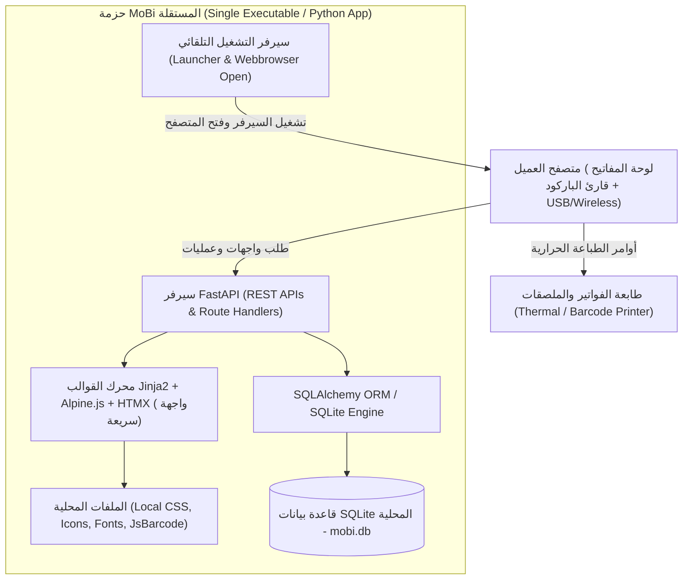
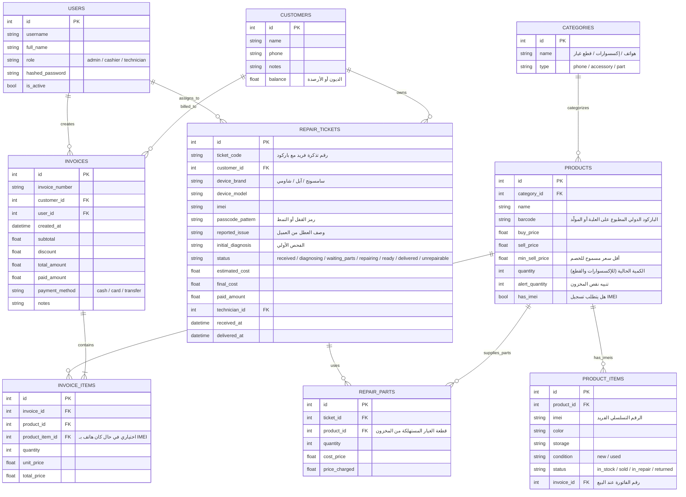

# خطة عمل ومعمارية نظام MoBi لإدارة محلات الهواتف والصيانة (POS & Workshop Management)

نظام **MoBi** هو منصة تشغيلية متكاملة مصممة خصيصاً لتلبية احتياجات محلات الهواتف النقالة وورش الصيانة، تعمل بنظام **Offline-First (دون الحاجة لاتصال بالإنترنت)**، وتتميز بدعم أجهزة قراءة وطباعة الباركود، تتبع الهواتف برقم الـ **IMEI**، وتذاكر الصيانة، وقابلة للحزم كملف تنفيذي مستقل (`.exe`) ليعمل بضغطة زر واحدة لدى العميل دون أي تعقيدات تقنية.

---

## 1. أهداف النظام والمتطلبات الأساسية (Goals & Scope)

1. **نقطة بيع سريعة (POS)** تدعم الإدخال الفوري عبر قارئ الباركود (HID Keyboard Emulation)، واختصارات لوحة المفاتيح، والبحث السريع بالاسم أو الباركود أو الـ IMEI.
2. **إدارة المخزون متعدد الأنماط:**
   - **الهواتف (جديدة ومستعملة):** تتبع فريد برقم الـ IMEI (أو Dual IMEI)، اللون، السعة، وحالة الجهاز (جديد/مستعمل/ضمان).
   - **الإكسسوارات:** دعم مسح الباركود الأصلي المطبوع مسبقاً على علب المنتجات (UPC/EAN)، مع دعم إضافة منتجات مجمعة أو توليد باركود لها.
   - **قطع الغيار (Spare Parts):** ربط قطع الغيار بقسم الصيانة وخصمها تلقائياً عند استخدامها في تذاكر الإصلاح.
3. **قسم ورشة الصيانة (Maintenance Workshop):**
   - إصدار تذكرة صيانة ذكية تتضمن بيانات العميل، نوع الجهاز، رقم الـ IMEI، رمز القفل، تشخيص العطل، وتكلفة تقريبية.
   - طباعة ملصق باركود صغير يُلصق على ظهر هاتف الزبون لسهولة الوصول للتذكرة لاحقاً بمجرد مسحه.
   - متابعة مراحل الصيانة (قيد الفحص، بانتظار القطع، تم الإصلاح، جاهز للتسليم، تم التسليم، غير قابل للإصلاح).
4. **الطباعة الحرارية وملصقات الباركود:**
   - قوالب فواتير حرارية قياسية (80mm و 58mm) متوافقة مع جميع طابعات الـ Thermal Receipt عبر نافذة طباعة المتصفح بـ CSS دقيق.
   - إيصالات استلام صيانة تحتوي على باركود التذكرة وشروط الضمان.
   - توليد ملصقات باركود قياسية وطباعتها على ورق الملصقات (Stickers).
5. **الخزينة والتقارير المالية:**
   - رصد المبيعات اليومية، أرباح المبيعات، أرباح الصيانة، وحركات الصندوق والديون (إن وجدت).
6. **أدوار المستخدمين (RBAC):**
   - **المدير (Admin):** كامل الصلاحيات والتحكم بالأسعار وتكلفة الشراء والتقارير وحذف السجلات.
   - **الكاشير (Cashier):** واجهة البيع السريعة، إدخال المبيعات، واستلام فواتير العملاء.
   - **فني الصيانة (Technician):** الاطلاع على أجهزة الصيانة، تحديث حالات الإصلاح، واستهلاك قطع الغيار.
7. **العمل دون إنترنت واستقلالية الحزمة (Offline & Standalone Executable):**
   - لا تتطلب تشغيل Node.js أو قواعد بيانات خارجية معقدة.
   - تخزين محلي بالكامل في `SQLite` مع كافة ملفات التنسيق والخطوط محلياً (Zero External CDNs).
   - تجهيز سكريبت الحزم لإنتاج ملف `.exe` بنقرة واحدة عبر `PyInstaller`.

---

## 2. المعمارية التقنية للمشروع (Architecture & Tech Stack)



- **اللغة:** Python 3.13.
- **إطار العمل الخلفي (Backend):** FastAPI (أداء عالي وسرعة استجابة متناهية، توثيق تلقائي، ودعم خفيف جداً).
- **قاعدة البيانات:** SQLite3 محلية، عبر SQLAlchemy 2.0 لإدارة العلاقات والهجرات بكل كفاءة وموثوقية.
- **الواجهة الأمامية (Frontend):**
  - Jinja2 Server-Side Templates.
  - HTMX للتحديثات الجزئية اللحظية (Reactive UI) بدون إعادة تحميل الصفحة.
  - Alpine.js للتحكم بالحركات التفاعلية، النوافذ المنبثقة، واختصارات لوحة المفاتيح.
  - Local Bundled Tailwind CSS + خطوط عربية محلية (Cairo / Tajawal) + مكتبة JsBarcode محلية لتوليد الباركود.
- **التشغيل المباشر والحزم (Packaging):**
  - ملف تشغيل رئيسي `run.py` يقوم بإنشاء قاعدة البيانات تلقائياً، إطلاق سيرفر Uvicorn، وفتح المتصفح فوراً على `http://127.0.0.1:8000`.
  - ملف إعدادات `mobi.spec` لتوليد ملف `MoBi.exe` عبر PyInstaller مع كافة الملحقات والقوالب.

---

## 3. مخطط هيكل قاعدة البيانات (Database Schema Overview)



---

## 4. هيكلية الملفات المقترحة للمشروع (Project Structure)

```text
MoBi/
├── AGENTS.md                  # دليل وإرشادات الذكاء الاصطناعي ومعايير تطوير المشروع
├── README.md                  # نظرة عامة وطريقة التشغيل للمستخدم والمطور
├── requirements.txt           # مكتبات بايثون المطلوبة (FastAPI, Uvicorn, SQLAlchemy, etc.)
├── run.py                     # سكريبت التشغيل الذاتي والنافذة الفورية
├── package_app.py             # أداة حزم المشروع بملف تنفيذي عبر PyInstaller
├── mobi.spec                  # ملف مواصفات التجميع
│
├── app/
│   ├── __init__.py
│   ├── main.py                # نقطة انطلاق سيرفر FastAPI وتضمين الموجهات والملفات الثابتة
│   ├── config.py              # إعدادات النظام (مسار الداتابيز، إعدادات المتجر، والعملة)
│   ├── database.py            # ربط SQLAlchemy وجلسات SQLite المحلية
│   │
│   ├── models/                # نماذج قاعدة البيانات (SQLAlchemy Models)
│   │   ├── __init__.py
│   │   ├── user.py
│   │   ├── product.py
│   │   ├── customer.py
│   │   ├── invoice.py
│   │   ├── repair.py
│   │   └── settings.py
│   │
│   ├── schemas/               # هياكل Pydantic للتحقق
│   │   └── ...
│   │
│   ├── services/              # منطق الأعمال (Business Logic)
│   │   ├── auth_service.py    # المصادقة والجلسات والتشفير
│   │   ├── pos_service.py     # معالجة فواتير البيع وحركات المخزون والـ IMEI
│   │   ├── repair_service.py  # إدارة تذاكر الصيانة واستهلاك القطع
│   │   └── report_service.py  # حساب الأرباح، جرد الصندوق، والنواقص
│   │
│   ├── routes/                # مسارات الويب وواجهات HTMX
│   │   ├── __init__.py
│   │   ├── auth.py            # تسجيل الدخول والخروج
│   │   ├── dashboard.py       # لوحة المؤشرات والإحصائيات
│   │   ├── pos.py             # شاشة نقطة البيع السريعة وقارئ الباركود
│   │   ├── inventory.py       # إدارة المنتجات، هواتف الـ IMEI، والإكسسوارات
│   │   ├── repairs.py         # شاشات ورشة الصيانة وتذاكر الاستلام
│   │   ├── customers.py       # سجل الزبائن والديون
│   │   ├── reports.py         # التقارير اليومية والشهرية والمالية
│   │   └── settings.py        # بيانات المحل، الشعار، العملة، وتهيئة الطابعات
│   │
│   ├── templates/             # قوالب Jinja2 للواجهة (HTML)
│   │   ├── base.html          # الهيكل الأساسي للواجهة (RTL + شريط التنقل + التنبيهات)
│   │   ├── auth/
│   │   │   └── login.html
│   │   ├── dashboard/
│   │   │   └── index.html
│   │   ├── pos/
│   │   │   ├── index.html     # واجهة الكاشير (سريعة، أزرار واختصارات)
│   │   │   ├── cart_row.html  # مكون جزئي لسطر السلة عبر HTMX
│   │   │   └── receipt.html   # قالب الطباعة الحرارية (80mm / 58mm)
│   │   ├── inventory/
│   │   │   ├── index.html
│   │   │   ├── product_form.html
│   │   │   └── barcode_labels.html # قالب طباعة ملصقات الباركود
│   │   ├── repairs/
│   │   │   ├── index.html
│   │   │   ├── ticket_form.html
│   │   │   ├── ticket_detail.html
│   │   │   └── ticket_print.html   # إيصال العميل وملصق الهاتف
│   │   ├── reports/
│   │   │   └── index.html
│   │   └── settings/
│   │       └── index.html
│   │
│   └── static/                # كافة الأصول المحلية (بدون إنترنت إطلاقاً)
│       ├── css/
│       │   ├── tailwind.min.css # نسخة Tailwind مدمجة محلياً
│       │   ├── custom.css      # تنسيقات مخصصة للطباعة الحرارية والتمرير
│       │   └── fonts.css       # ربط الخطوط المحلية
│       ├── js/
│       │   ├── htmx.min.js     # مكتبة HTMX
│       │   ├── alpine.min.js   # مكتبة Alpine.js
│       │   ├── jsbarcode.all.min.js # مكتبة توليد الباركود محلياً
│       │   └── pos_scanner.js  # معالج مدخلات قارئ الباركود والماسح التلقائي
│       ├── fonts/              # خطوط عربية محملة محلياً (Cairo)
│       └── sounds/             # أصوات التنبيه (بيب نجاح المسح / تنبيه الخطأ)
```

---

## 5. ميزات خاصة بتجربة مستخدم محلات الهواتف (Special UX Features)

### أ. معالج الباركود الذكي (Barcode Scanner Handler):
- مسح باركود العلبة (UPC/EAN) يضيف الإكسسوار فوراً إلى سلة المبيعات مع تشغيل صوت "Beep" تأكيدي خفيف.
- مسح رقم الـ IMEI يتحقق تلقائياً من توفر الجهاز في المخزون وحالته، ويضيفه بالرقم التسلسلي للفاتورة.
- إمكانية الإدخال اليدوي مع خيار البحث الذكي الحي (Autocomplete) عند عدم توفر باركود.

### ب. ورشة الصيانة واستلام الأجهزة:
- نموذج استلام جهاز يطبع فوراً:
  1. **إيصال استلام للزبون:** يحتوي على شروط الصيانة، المشكلة المذكورة، التكلفة التقريبية، وباركود التذكرة.
  2. **ملصق صغير (Sticker):** يحتوي على اسم الزبون، كود التذكرة، ونوع العطل ليُلصق خلف الجهاز حتى لا يختلط بغيره.
- بمجرد مسح باركود الملصق في أي وقت، تفتح شاشة التذكرة مباشرة لتحديث حالتها أو تسليمها.

### ج. فواتير الطباعة الحرارية المجهزة:
- تنسيق فواتير بحجم 80mm و 58mm مع ترويسة باسم المحل، الشعار، أرقام التواصل، تفاصيل الأصناف والـ IMEI المباع، وشروط الاسترجاع والاستبدال.

---

## 6. خطة التنفيذ خطوة بخطوة (Phased Roadmap)

### المرحلة 1: إعداد ملف `AGENTS.md` وهيكلة المشروع الأساسية
- كتابة وتثبيت ملف `AGENTS.md` في مسار المشروع ليكون المرجع الشامل لقواعد الكود وتوجيهات الذكاء الاصطناعي ومعايير النظام.
- إعداد بيئة بايثون وتثبيت متطلبات المشروع الأساسية (`fastapi`, `uvicorn`, `jinja2`, `sqlalchemy`, `pydantic`, `python-multipart`, `passlib`, `bcrypt`).
- إنشاء الهيكل الشجري للمشروع وتجهيز الملفات الثابتة المحلية (CSS, JS, Fonts).

### المرحلة 2: نواة النظام، قاعدة البيانات، والمصادقة
- برمجة نماذج SQLAlchemy (`User`, `Product`, `ProductItem/IMEI`, `Category`, `Customer`, `Invoice`, `RepairTicket`, `Settings`).
- إنشاء آلية التأسيس الأولي التلقائي (Auto-Seeding) لإنشاء حساب المدير الافتراضي (`admin / admin123`) والفئات الرئيسية.
- إعداد نظام الجلسات والمصادقة ومحددات الصلاحيات (Admin, Cashier, Technician).

### المرحلة 3: شاشة نقطة البيع السريعة (POS) والباركود
- بناء واجهة الكاشير التفاعلية عبر Jinja2 + HTMX مع دعم كامل للغة العربية واتجاه RTL.
- برمجة سكريبت استقبال مدخلات قارئ الباركود (Barcode Listener) والتعرف على المنتجات والـ IMEI.
- إنشاء منطق حفظ الفاتورة وطباعة الإيصال الحراري الفوري (80mm / 58mm).

### المرحلة 4: إدارة المخزون وتوليد ملصقات الباركود
- واجهات إضافة وإدارة المنتجات (مع دعم باركود العلبة الحالي أو توليد باركود تلقائي).
- واجهة إدارة الهواتف بالأرقام التسلسلية (IMEI Management) وتتبع حالتها (متاح / مباع / مسترجع).
- شاشة طباعة ملصقات الباركود القابلة للتخصيص.

### المرحلة 5: قسم ورشة الصيانة (Maintenance Hub)
- شاشة تذاكر الصيانة (إنشاء، فحص، تقدير تكلفة، تحديد الفني).
- ربط استهلاك قطع الغيار بخصمها التلقائي من مخزون القطع.
- طباعة إيصالات الاستلام وملصقات الأجهزة.

### المرحلة 6: التقارير، الإعدادات، والتشغيل التلقائي
- لوحة تحكم إحصائية تعرض إجمالي المبيعات، أرباح الصيانة، والمنتجات الأكثر طلباً.
- شاشة إعدادات المحل (تعديل الاسم، الهاتف، الشعار، العملة).
- برمجة `run.py` للتشغيل بنقرة واحدة وفتح المتصفح تلقائياً.
- إعداد سكريبت التجميع `package_app.py` وملف `mobi.spec` لتحويل المشروع لملف `.exe`.

---

## 7. خطة التحقق والاختبار (Verification Plan)

### الاختبارات البرمجية والآلية:
- التحقق من تشغيل الخادم وتجاوب المسارات بدون أخطاء:
  `python -m uvicorn app.main:app --port 8000`
- اختبار تسجيل الدخول، إنشاء المنتجات بـ IMEI وباركود، وإتمام فاتورة POS.
- اختبار دورة حياة تذكرة الصيانة وحساب تكلفتها وخصم قطع الغيار.

### الفحص اليدوي (Manual Inspection):
- فتح شاشة POS وتجربة قراءة باركود تجريبي بالماسح أو الكتابة السريعة.
- فحص معاينة الطباعة الحرارية (Print Preview) للتأكد من انضباط العرض على مقاس 80mm و 58mm دون زوائد أفقية.
- التأكد من عمل كامل الواجهات أثناء قطع الاتصال بالإنترنت تماماً.
